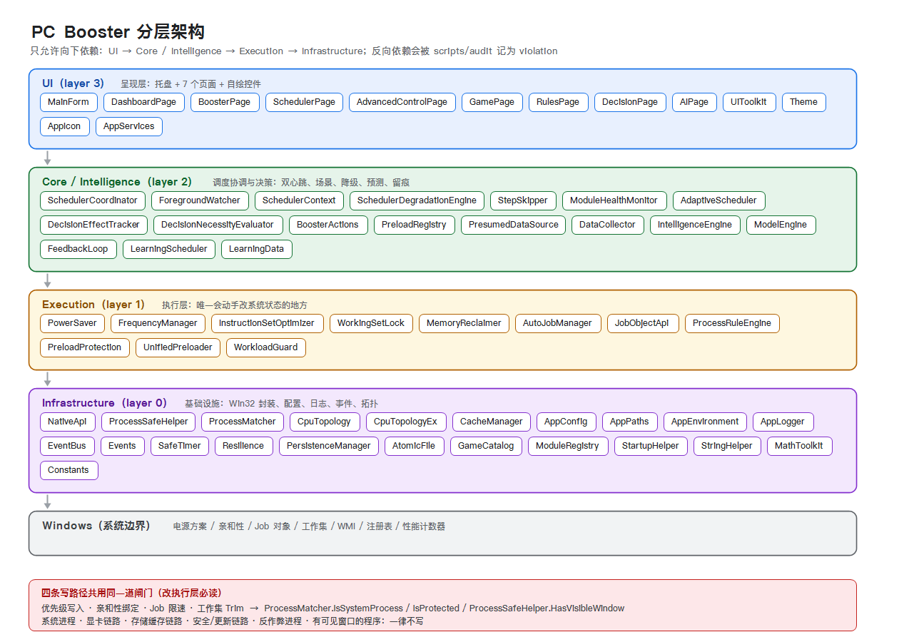
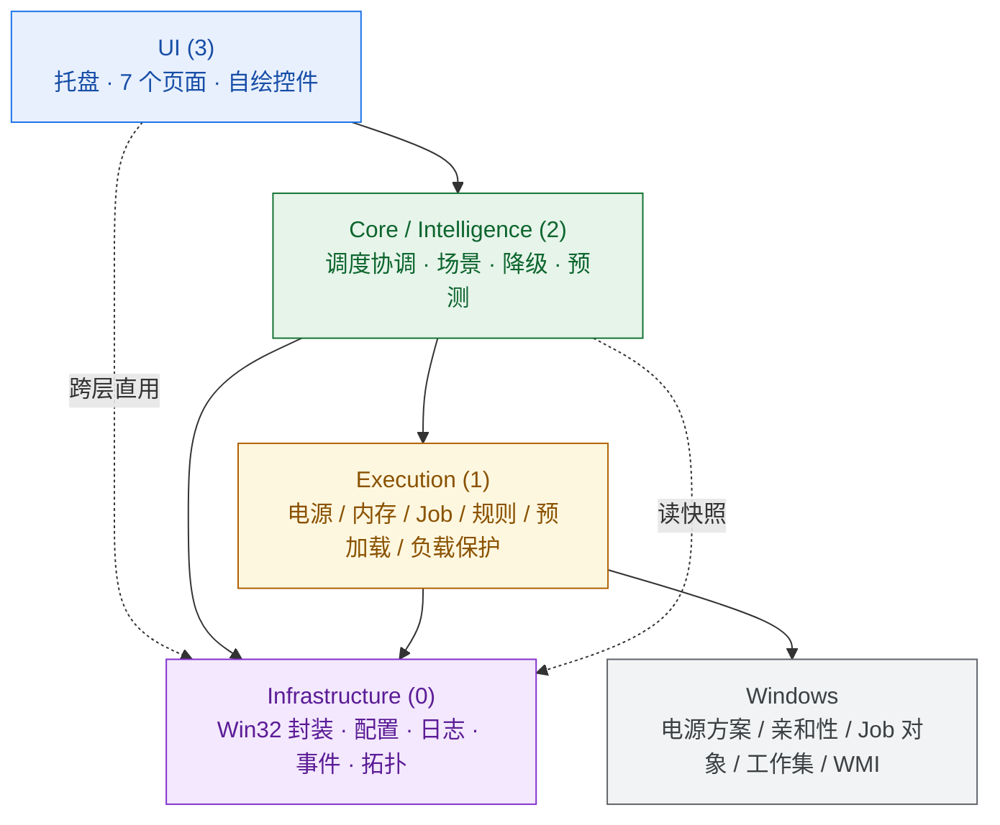
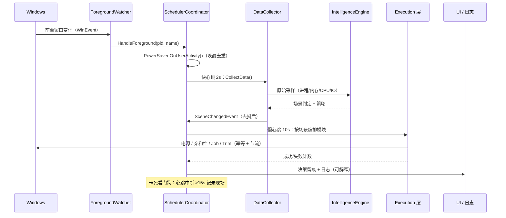
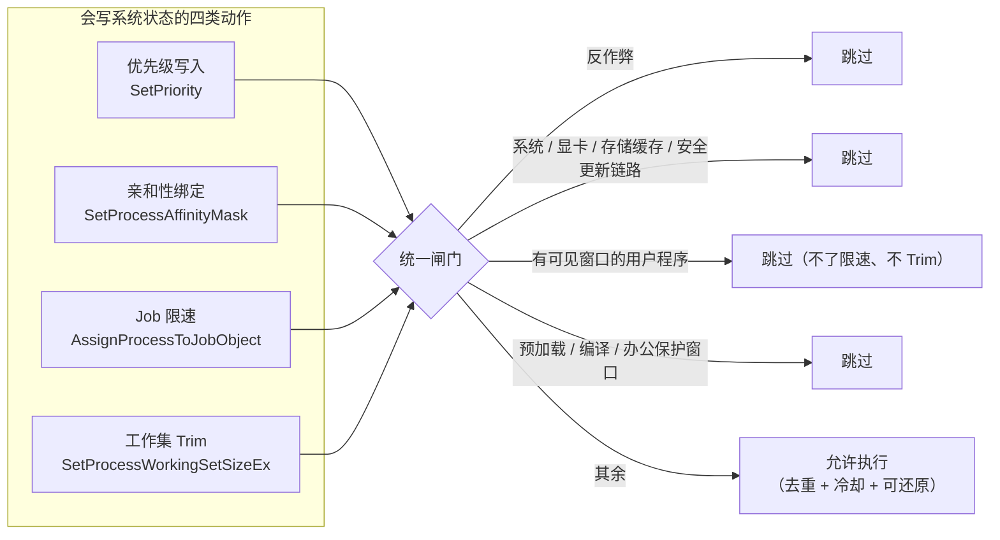

# 分层架构



> 图由 `scripts/gen-layers-png.ps1`（PNG）和 `scripts/gen-layers-svg.ps1`（SVG）根据源码目录生成，改代码后可重跑，保证图与实现同步。

---

## 1. 依赖规则（唯一一条硬规则）

```
UI (3)  →  Core / Intelligence (2)  →  Execution (1)  →  Infrastructure (0)
```

**只允许向下依赖。** 反向引用会被审计脚本记为 `violation`，基线是 10 条历史欠账，**不允许新增**。



**为什么这样分**：把"会改系统状态"的代码全部关进 Execution 一层，好处是——审代码时只需看这一层是否守规矩，UI 和决策层随便改都不会直接弄坏系统。

---

## 2. 各层职责

### Infrastructure (0) — `Infrastructure/{Common,Native,Cache,Profiling}`

| 模块 | 职责 |
|---|---|
| `NativeApi` | 所有 Win32 P/Invoke：电源方案读写、亲和性、工作集、快照、WMI 频率、系统还原 |
| `ProcessSafeHelper` | 进程操作的安全包装：优先级/亲和性/Trim 的 try-catch + 缓存；`HasVisibleWindow`（EnumWindows 一次扫描 + 30s 缓存） |
| `ProcessMatcher` | 分类判据：是否系统进程 / 反作弊 / 游戏 / 浏览器 / 办公 / 编译工具 / 显卡链路 / 存储链路 |
| `CpuTopology` / `CpuTopologyEx` | 物理核/逻辑核、SMT 兄弟、L3 域（AMD CCD / Intel ring）、P/E 核能效等级、掩码计算 |
| `CacheManager` | 内存/页缓存/磁盘快照，统一提供各层读 |
| `AppConfig` / `AppPaths` / `PersistenceManager` / `AtomicFile` | 配置与持久化（原子写，避免半截文件） |
| `AppLogger` | 队列落盘日志（`Shutdown()` 后不再接收，注意顺序） |
| `EventBus` / `Events` | 进程内事件总线（前台切换、场景变化、进程启动/退出、预测命中） |
| `SafeTimer` / `Resilience` / `ModuleHealthMonitor` | 定时器与故障隔离（单模块异常不拖垮全能） |
| `GameCatalog` | 游戏目录识别（名称 + 安装路径 + 进程名） |

### Execution (1) — `Execution/{Power,Memory,Jobs,Rules,Preload,Work}`

**唯一会真正写系统状态的一层。**

| 模块 | 写入对象 | 关键约束 |
|---|---|---|
| `PowerSaver` | 电源方案、核心停泊、待机（Active/LightStandby/Standby/DeepSleep） | 状态机有迟滞；唤醒去重；AC/电池切换重评估 |
| `FrequencyManager`（`PowerTuning`） | 电源设置项 + 方案激活、睿频档 | **幂等**（值不变不写）+ 场景稳定 3s 才锁 + 转场最短间隔 15s |
| `InstructionSetOptimizer`（`PowerTuning`） | 进程亲和性、优先级、后台核心罩 | 掩码 30s 内不重写；快照扫描 ≥5s；与其它调度工具互斥让位 |
| `WorkingSetLock`（`PowerTuning`） | 工作集下限（`SetProcessWorkingSetSizeEx`） | **按 PID 去重**（历史上漏了这条，前台事件每次都会重写） |
| `MemoryReclaimer` | 工作集 Trim | 冷/热判据 + 期限；跳过保护/系统/有窗口/缓存进程 |
| `AutoJobManager` / `JobObjectApi` | Job 对象 CPU/内存限速 | 有窗口的程序永不限速；编译器不算"抢占" |
| `ProcessRuleEngine` | 用户自定义规则（优先级/亲和性/排除） | 规则可停用；匹配失败要可解释 |
| `PreloadProtection` / `UnifiedPreloader` | 预加载进程保护 | 预加载期间禁止 Trim/限速 |
| `WorkloadGuard` | 判定层（不改状态） | 编译/办公/浏览器活跃期免打扰窗口 |

### Core / Intelligence (2) — `Core/`、`Intelligence/`

| 模块 | 职责 |
|---|---|
| `SchedulerCoordinator` | 双速心跳（快 2s / 慢 10s）、模块编排、卡死看门狗、退出还原 |
| `ForegroundWatcher` | 前台窗口变化（WinEvent 钩子 + 轮询兜底） |
| `SchedulerContext` / `PresumedDataSource` | 一轮调度内的共享上下文与快照 |
| `SchedulerDegradationEngine` / `StepSkipper` | 降级等级（Normal→Degraded→Minimal）与步骤跳过 |
| `ModuleHealthMonitor` | 各模块成功/失败计数，驱动降级 |
| `AdaptiveScheduler` / `DecisionEffectTracker` / `DecisionNecessityEvaluator` | 决策效果跟踪与"是否还值得做"的评估 |
| `BoosterActions` | 供 UI 调用的动作入口（立即提升/还原） |
| `DataCollector` | 采样、场景判定（**含去抖 `ConfirmScene`**）、启动/退出事件 |
| `IntelligenceEngine` / `ModelEngine` | 进程分类与策略表 |
| `FeedbackLoop` / `LearningScheduler` / `LearningData` | 预测反馈与学习数据持久化 |

### UI (3) — `UI/`

`MainForm`（托盘 + 页面宿主）· `DashboardPage`（总览）· `BoosterPage`（提升）· `SchedulerPage`（进程调度）· `AdvancedControlPage`（高级开关）· `GamePage` · `RulesPage` · `DecisionPage`（决策日志）· `AIPage` · `UiToolkit` / `Theme`（尺寸必须走 `Theme.S()/Sf()`）。

---

## 3. 运行时数据流



**两条心跳的分工**：快心跳只做"读 + 判"，绝不写系统（保证 2 秒节拍不会被慢操作拖住）；慢心跳才执行写操作。这条边界是性能与稳定的关键。

---

## 4. 四条写路径与统一闸门



对应代码：

```csharp
ProcessMatcher.IsProtected(name)          // 反作弊：绝对不碰
ProcessMatcher.IsSystemProcess(name)      // 系统 / 显卡链路 / 存储链路 / 安全更新
ProcessSafeHelper.HasVisibleWindow(pid)   // 用户正在用的窗口程序
WorkloadGuard.IsTrimExempt / IsJobExempt  // 编译 / 办公 / 浏览器保护窗口
```

新增执行动作时，**这四道检查缺一不可**（详见 [SAFETY.md](SAFETY.md)）。

---

## 5. 审计基线

```powershell
node scripts/parse_cs3.mjs       # 生成 cs_parse.json（已 gitignore）
node scripts/audit_report.mjs    # 生成 audit_report.txt（已 gitignore）
```

当前基线（提交初始版本时）：

| 指标 | 值 |
|---|---|
| 文件数 | 65 个 .cs |
| 大括号平衡 | 65/65 |
| UTF-8 无 BOM | 全部 |
| 循环依赖 | 2 条（历史欠账，已评估） |
| 分层违规 | 10 条（历史欠账，**不允许新增**） |
| 疑似死代码 | 12 条（全部是 P/Invoke 结构体字段） |
| TODO / FIXME | 0 |

---

## 6. 想加功能，改哪一层？

| 你想做的事 | 改哪里 |
|---|---|
| 加一个设置项 / 页面 | UI（+ `AppConfig` 键） |
| 识别新场景 / 改分类规则 | `Intelligence`（`DataCollector` / `ModelEngine` / `ProcessMatcher`） |
| 加一种新的系统优化动作 | `Execution` 新模块 + 在 `SchedulerCoordinator` 编排 + **过四道闸门** |
| 支持新 CPU 拓扑（多 CCD / 混合核 / >64 核） | `Infrastructure/Profiling/CpuTopologyEx` |
| 改调度节奏 / 降级策略 | `Core/SchedulerCoordinator` + `SchedulerDegradationEngine` |

修改后务必跑一遍构建与审计，并手动验证：进游戏 → 切窗口 → 退游戏 → 待机唤醒 → 退出程序，确认状态全部还原。
